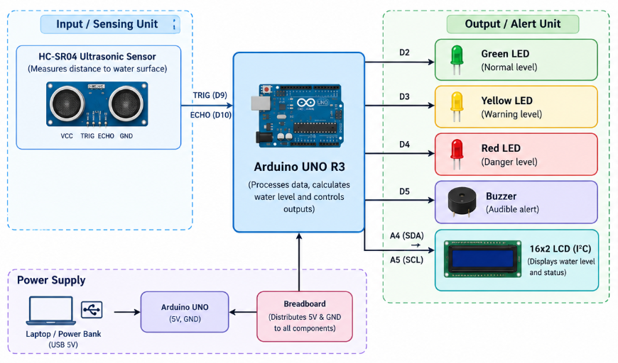
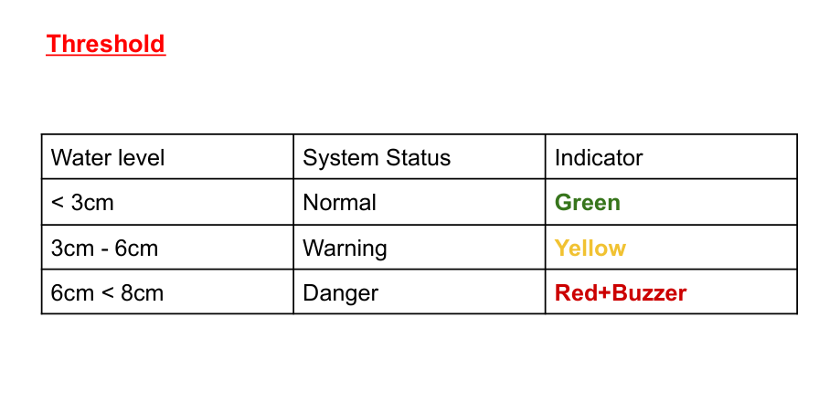

# 🌊 Arduino-Based River Water Level Monitoring System

**An Arduino-based river water level monitoring prototype developed during FOSSEE Hardware Makethon at IIT Bombay.**

---

## 📌 1. Project Overview

Rising river water levels can pose significant risks to nearby communities, particularly during periods of heavy rainfall. Monitoring changes in water levels can help identify potentially unsafe conditions and support early awareness.

This project presents an Arduino-based River Water Level Monitoring System that measures water levels using an ultrasonic sensor and provides visual and audible alerts based on predefined thresholds.

The prototype uses an Arduino Uno as its main controller, an HC-SR04 ultrasonic sensor for distance measurement, an LCD for displaying readings, LEDs for visual indication and a buzzer for audible alerts.

## 🎯 2. Objectives

- Monitor river water levels using ultrasonic distance measurement.
- Display water-level readings and status on an LCD.
- Classify water levels into Normal, Warning and Danger conditions.
- Provide visual alerts using LEDs.
- Generate audible alerts using a buzzer.
- Develop a simple, low-cost educational prototype for water-level monitoring.

---

## 🔧 3. Components Used

The prototype consists of the following hardware components:

| Component | Function |
|---|---|
| Arduino Uno R3 | Main microcontroller |
| HC-SR04 Ultrasonic Sensor | Measures distance between sensor and water surface |
| 16×2 LCD with I2C | Displays water-level readings and status |
| Green LED | Indicates normal condition |
| Yellow LED | Indicates warning condition |
| Red LED | Indicates danger condition |
| Active Buzzer | Provides audible alerts |
| Breadboard | Circuit prototyping |
| Jumper Wires | Electrical connections |

### Components Diagram

---

## ⚙️ 4. Working Principle

The system operates on the principle of ultrasonic distance measurement.

1. The HC-SR04 ultrasonic sensor is positioned at a fixed height above the river bed.
2. The sensor transmits ultrasonic waves towards the water surface.
3. These waves are reflected back and received by the sensor.
4. The Arduino calculates the distance between the sensor and the water surface using the echo travel time.
5. The water level is calculated using the fixed sensor mounting height.
6. The measured water level is compared against predefined thresholds.
7. The LCD displays the readings and corresponding status, while LEDs and the buzzer provide alerts.

### Water-Level Calculation

**Water Level = Sensor Height from River Bed − Distance from Sensor to Water Surface**

---

## 📏 5. Water-Level Thresholds

The prototype uses three predefined water-level conditions:

| Water Level | Condition | Output |
|---|---|---|
| Below 3 cm | Normal | Green LED |
| 3 cm to below 6 cm | Warning | Yellow LED |
| 6 cm to 8 cm | Danger | Red LED + Buzzer |

### Sensor Positioning

- Sensor mounting height: 14 cm above the river bed.
- Maximum modelled water level: 8 cm.
- Sensor clearance above maximum water level: 6 cm.

The ultrasonic sensor is positioned 6 cm above the maximum modelled water level.

### Threshold Diagram

---

## 🔌 6. Circuit Connections

The Arduino Uno acts as the central controller, interfacing with the ultrasonic sensor, LCD, LEDs and buzzer.

### Pin-Wise Connections

The following diagram illustrates the hardware connections between the Arduino Uno and the individual components.

### System Architecture

The overall system architecture illustrates the flow of data from the ultrasonic sensor to the Arduino and the corresponding output devices.

---

## 💻 7. Arduino Source Code

The complete Arduino source code is available in the Code folder.

**[View Arduino Source Code](Code/river_water_monitor.ino)**

The program handles:

- Ultrasonic sensor initialisation and distance measurement.
- Water-level calculation.
- Classification of readings into predefined conditions.
- LCD output.
- LED indicators and buzzer alerts.

---

## 📸 8. Project Gallery

### Prototype Setup

The following image showcases the hardware prototype developed for the FOSEE Hardware Makethon.

---

## 🎥 9. Project Demonstration

A demonstration video showcasing the working prototype, ultrasonic water-level measurement and corresponding alert indications is available here:

**[Watch Project Demonstration](Videos/demo_video_link.md)**

---

## 🏆 10. Event

**FOSEE Hardware Makethon | IIT Bombay**

Participated in the hardware makethon organised by FOSEE at IIT Bombay, where this Arduino-based river water level monitoring prototype was developed and demonstrated.

---

## 🚀 11. Future Scope

- Integration of wireless communication for remote monitoring.
- Real-time water-level data logging.
- Remote alerts and notifications.
- Deployment of multiple monitoring units for larger water bodies.
- Integration with cloud-based monitoring platforms.

---

## ⚠️ Disclaimer

This project is an educational hardware prototype developed for demonstration purposes. It is not a certified flood-warning system and should not be used as a standalone public safety or flood prediction system.

---

**Developed as part of FOSSEE Hardware Makethon, IIT Bombay.**
